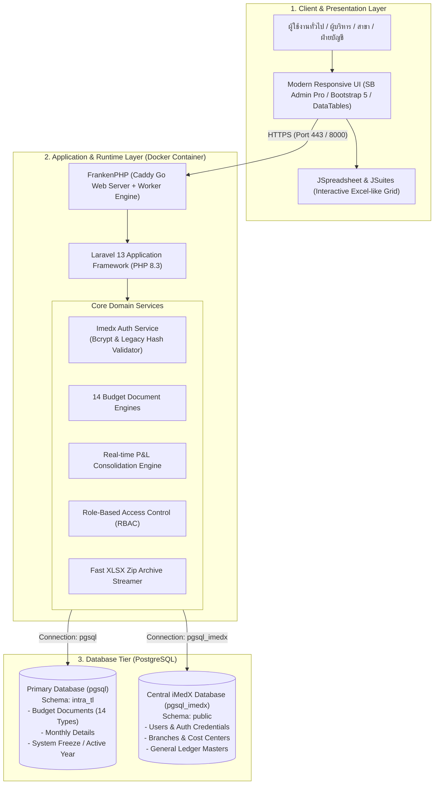

# รายละเอียดสถาปัตยกรรมและการทำงานของระบบ E-Budget (PHP 8.3 & Laravel 13)

ระบบจัดทำและบริหารจัดการงบประมาณองค์กร (**E-Budget Application**) สำหรับกลุ่มโรงพยาบาลสัตว์ทองหล่อ (Thonglor Pet Hospital Group)  
พัฒนาและยกระดับสถาปัตยกรรมสู่ **PHP 8.3** และ **Laravel 13** บนเว็บเซิร์ฟเวอร์ประสิทธิภาพสูง **FrankenPHP (Go Caddy Server)**

---

## 1. วัตถุประสงค์และภาพรวมของระบบ (System Purpose & Overview)

ระบบ E-Budget ได้รับการออกแบบขึ้นเพื่อเป็นศูนย์กลางการจัดทำงบประมาณประจำปีขององค์กร โดยครอบคลุมกระบวนการตั้งแต่ระดับสาขาจนถึงระดับกลุ่มบริษัท (TLPH Group):
- บันทึกและวางแผนค่าใช้จ่ายด้านบุคลากร (Manpower), สินทรัพย์และอุปกรณ์ (Fix Asset / Equipment), ค่าใช้จ่ายดำเนินงาน (Expense / GL Entry), และประมาณการรายได้ (Revenue)
- คำนวณและประมวลผลงบประมาณรายเดือน (12 เดือน) แบบ Carry-forward และคำนวณสัดส่วนค่าเสื่อมราคา
- ควบคุมการจัดทำงบประมาณตามช่วงเวลาผ่านระบบ **Budget Freeze**
- แสดงผลการวิเคราะห์ทางการเงินและงบกำไรขาดทุน (P&L Analytics) แบบ Real-time พร้อมส่งออกรายงาน Excel (.xlsx)

---

## 2. สถาปัตยกรรมทางเทคนิค (Technical Architecture)

### 2.1 เทคโนโลยีหลักที่ใช้ (Core Technologies)
- **ภาษาและเฟรมเวิร์ก:** PHP 8.3, Laravel 13
- **เว็บเซิร์ฟเวอร์:** FrankenPHP (Go-based Caddy Web Server with PHP Worker Mode)
- **ฐานข้อมูล:** PostgreSQL (Dual-database Architecture)
- **Frontend & UI:** Blade Templates, SB Admin Pro, Bootstrap 5, JSpreadsheet (JExcel CE), JSuites, TomSelect, DataTables, FontAwesome 6, Feather Icons, ฟอนต์ Metropolis

---

## 3. ระบบยืนยันตัวตนและการจัดการสิทธิ์ (Dual Auth & RBAC)

### 3.1 ระบบยืนยันตัวตนและการจัดการรหัสผ่าน (Authentication Engine)
รองรับการยืนยันตัวตนร่วมกับระบบบัญชีกลางของ iMedX ผ่าน Custom `ImedxUserProvider`:
1. **iMedX SSO Authentication:** ตรวจสอบรหัสผ่าน MD5 และสถานะพนักงาน (`active = '1'`, `bank_sub_name`, `bank_account_note`) โดยตรงจากฐานข้อมูล iMedX
2. **Native Bcrypt & Hash Validation:** รองรับการยืนยันรหัสผ่านบัญชีระบบมาตรฐาน PHP 8.3 & Laravel 13 โดยปลดระวางสถาปัตยกรรม Python Django ออกจากระบบโดยสมบูรณ์

### 3.2 การควบคุมสิทธิ์ตามบทบาท (Role-Based Access Control)
- **IT-Admin / Superuser:** ดูแลความปลอดภัย, จัดการปีงบประมาณ, ควบคุมการ Freeze ระบบ, อัปเดตข้อมูลทุกสาขา
- **Executive View-Only:** ตรวจสอบงบประมาณและ P&L แดชบอร์ดภาพรวมทุกสาขา (ไม่มีสิทธิ์สร้างหรือแก้ไขเอกสาร)
- **District Manager:** จัดการและกำกับดูแลกลุ่มสาขาที่ได้รับมอบหมาย
- **Branch Officer / Manager:** จัดทำและแก้ไขเอกสารงบประมาณเฉพาะสาขาของตนเอง

---

## 4. โมดูลเอกสารงบประมาณ 14 ประเภท (14 Budget Document Engines)

| ลำดับ | ประเภทเอกสาร | Model | Document Prefix | เงื่อนไขและลักษณะเฉพาะทางธุรกิจ |
| :---: | :--- | :--- | :---: | :--- |
| 1 | **VET Manpower** | `VetManpower` | `VET-` | บุคลากรทางการแพทย์ (สัตวแพทย์): คำนวณเงินเดือน, วิชาชีพ, Carry-forward รายเดือน |
| 2 | **Non-VET Manpower** | `NonVetManpower` | `NONVET-` | บุคลากรทั่วไป: คำนวณเงินเดือนแยกกับค่าวัดระดับอัตโนมัติ |
| 3 | **Position Adjustment** | `PositionAdjustment` | `ADJ-` | ปรับระดับตำแหน่ง: คำนวณส่วนต่างอัตราเงินเดือนและค่าวัดระดับ |
| 4 | **Medical Equipment** | `MedicalEquipment` | `MED-` | เครื่องมือแพทย์: ราคา >= 5,000 เข้าสินทรัพย์ถาวร (GL 61300010), ต่ำกว่า 5,000 เข้าค่าใช้จ่าย (GL 60300002) |
| 5 | **Computer Equipment** | `ComputerEquipment` | `COM-` | คอมพิวเตอร์และอุปกรณ์ไอที: ราคา >= 5,000 (GL 61300004), ต่ำกว่า 5,000 (GL 60300002) |
| 6 | **Furniture** | `Furniture` | `FUR-` | เฟอร์นิเจอร์และเครื่องใช้สำนักงาน: ราคา >= 5,000 (GL 61300012), ต่ำกว่า 5,000 (GL 60600003) |
| 7 | **Tools & Equipment** | `ToolsEquipment` | `TEQ-` | เครื่องมือและเครื่องใช้: ราคา >= 5,000 (GL 61300011), ต่ำกว่า 5,000 (GL 60300002) |
| 8 | **Car / Vehicle** | `Car` | `CAR-` | ยานพาหนะ (GL 61300013) |
| 9 | **Renovate** | `Renovate` | `REN-` | งานต่อเติมและปรับปรุงสถานที่ (GL 61300008) |
| 10 | **Software** | `Software` | `SW-` | ซอฟต์แวร์และระบบสารสนเทศ (GL 61300005) |
| 11 | **Operating Expense** | `GlEntry` | `GLE-` | **ค่าใช้จ่ายดำเนินงาน:** แสดงและบันทึกเฉพาะรหัส GL ที่ขึ้นต้นด้วย `ค่าเสื่อม%` ทั้งหน้าสร้างงบและหน้าแก้ไขเอกสาร |
| 12 | **Revenue Budget** | `Revenue` | `REV-` | **ประมาณการรายได้:** กรองเฉพาะรหัส GL หมวดรายได้ (ขึ้นต้นด้วย `รายได้%`) |
| 13 | **Budget Plan (C03)** | `BudgetPlanItem` | `PLAN-` | แผนงบประมาณโครงการพิเศษรายปี |
| 14 | **GL Actual Template** | `GlActualTemplate` | `GLACT-` | บันทึกตัวเลข P&L Actual ตามเค้าโครงมาตรฐาน 181 บรรทัด |

---

## 5. แดชบอร์ดสรุปงบการเงิน Real-time และระบบส่งออก Excel

### 5.1 Real-time P&L Analytics Engine
- สรุปตัวเลขรายรับ, ต้นทุน, ค่าใช้จ่ายดำเนินงาน, และกำไรจากการดำเนินงาน (Operating Profit)
- รองรับการกรองตามสาขาเดี่ยว หรือสรุปผลรวมทุกสาขาในกลุ่ม TLPH ทั้งหมด
- ประมวลผลจากตารางรายเดือนโดยตรง เพื่อความถูกต้องและแม่นยำ 100%

### 5.2 ระบบตัวเลือก Cost Center ตามสิทธิ์ `emp.bank_sub_name` และบทบาทผู้ใช้งาน
- เพิ่มฟิลเตอร์ **Cost Center (ศูนย์ต้นทุน)** วางเคียงข้างตัวเลือกสาขา (Branch) เพื่อให้ผู้บริหารและหัวหน้าแผนกสามารถวิเคราะห์งบประมาณ P&L เจาะลึกตามหน่วยงานได้
- **เงื่อนไขการควบคุมสิทธิ์การมองเห็น Cost Center:**
  1. **กลุ่มผู้บริหารและผู้ดูแลระบบ (`COO`, `CFO`, `CHRO`, `ADMIN`, `IT-ADMIN`):** เห็นและเลือกดูได้ทุก Cost Center (ทั้งหมด 27 รายการ) หรือดูภาพรวม "ทั้งหมด"
  2. **กลุ่มผู้ใช้งานสาขาทั่วไป (`bank_sub_name` มีเฉพาะรหัสสาขา เช่น `R8,R5`, `RY`):** แสดงเฉพาะ 3 BU Cost Centers ของสาขา ได้แก่ `Center`, `PH (Pet Hospital+Pet Taxi)`, และ `PC (Pet Wellness+Pet Shop+GM+Pet Pool)`
  3. **กลุ่ม Back Office ที่ดูแลสาขา (เช่น `BACK-PC,R9,R2,R8`):** แสดงศูนย์ต้นทุนกลุ่มสาขา (`PC`, `PH`, `Center`)
  4. **กลุ่ม Back Office ประจำแผนก (เช่น `BACK-IT`, `BACK-HR`, `BACK-ACC`):** ถอดรหัสตัวย่อแผนกไปจับคู่กับ Master Data และแสดงเฉพาะ Cost Center ที่ตรงกับแผนกที่ระบุใน `bank_sub_name` เท่านั้น (เช่น `BACK-IT` &rarr; `แผนก IT`, `BACK-HR` &rarr; `แผนกบุคคล`)

### 5.3 High-Performance XLSX Export
- ส่งออกไฟล์ **Excel (.xlsx)** แบบ Multi-sheet พร้อมระบุข้อมูลสาขาและ Cost Center ที่เลือกในรายงาน
- ทำงานด้วย Zip Archive Streamer ที่สร้างโครงสร้าง OpenXML โดยตรงในระดับหน่วยความจำ ประหยัด RAM และทำงานได้รวดเร็วระดับมิลลิวินาที

---

## 6. กลไกควบคุมช่วงเวลางบประมาณ (Budget Freeze Control)

- **ระบบ Freeze:** ผู้ดูแลระบบสามารถสั่งปิดการแก้ไขงบประมาณประจำปีได้ทันทีผ่าน Web UI
- **การบังคับใช้:** ดำเนินการผ่าน Middleware `EnsureBudgetNotFrozen` ตรวจสอบทั้งหน้าสร้างเอกสารและ API แก้ไขเอกสาร
- **ข้อยกเว้น:** ผู้ดูแลระบบและผู้ได้รับสิทธิ์พิเศษ (Privileged Users) ยังคงสามารถเข้าปรับปรุงข้อมูลฉุกเฉินได้

---

## 7. จุดเด่นด้านเสถียรภาพและคุณภาพโค้ด (Stability & Best Practice)

1. **Production DB Integrity Guarantee:**
   - ยึดหลัก **Zero Schema Drop / Alter Rule** ไม่มีการเปลี่ยนแปลง Schema ของตารางเดิมในฐานข้อมูลหลักอย่างเด็ดขาด
2. **Typography Stability & Zero Layout Shift:**
   - กำหนด `@font-face` ด้วย `font-display: block` ควบคู่กับ `<link rel="preload">` ช่วยป้องกันอาการฟอนต์หลุดบนการ Hard Reload (`Ctrl + F5`) และตัดปัญหา FOUT (Flash of Unstyled Text) ได้อย่างสมบูรณ์
3. **Automated Testing Coverage:**
   - ชุดทดสอบอัตโนมัติครบถ้วนทั้ง Unit Tests และ Feature Integration Tests (ตรวจสอบการสร้างเอกสาร, การบันทึกลง Database, API Contracts, และ Authentication)
4. **Session Security & Inactivity Auto-Logout:**
   - เซสชันมีอายุการใช้งาน 1 ชั่วโมง (60 นาที) ตามมาตรฐานความปลอดภัย
   - ระบบตรวจจับความเคลื่อนไหว (User Activity Detection) กรองการสั่นของเซนเซอร์เมาส์ (Mouse Micro-Jitter Filter >= 10px) และรองรับการซิงค์ข้ามแท็บผ่าน `localStorage`
   - แจ้งเตือนล่วงหน้า 2 นาที (ที่นาทีที่ 58) ด้วยหน้าต่างนับถอยหลัง SweetAlert เพื่อให้ผู้ใช้งานกด "อยู่ในระบบต่อ" ได้ทันท่วงที
   - หากไม่มีการทำรายการจนครบ 1 ชั่วโมง หรือกรณีล็อกหน้าจอ/หลับไป ระบบจะทำ Auto-Logout ไปยังหน้า Login พร้อมแสดงหน้าต่าง SweetAlert แจ้งสาเหตุการออกจากระบบอย่างชัดเจน และรองรับการทดสอบทันใจด้วยพารามิเตอร์ `?test_idle=10` หรือฟังก์ชัน `window.__testIdlePopup()` ใน Console
