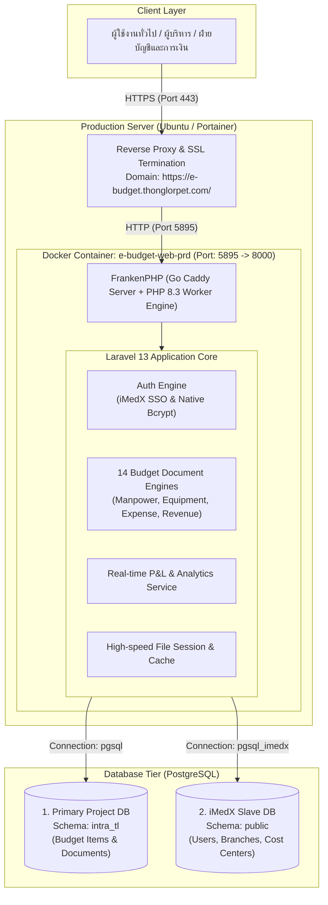

# E-Budget Web Application (PHP 8.3 & Laravel 13)

ระบบจัดทำและบริหารจัดการงบประมาณองค์กร (E-Budget) สำหรับกลุ่มโรงพยาบาลสัตว์ทองหล่อ (Thonglor Pet Hospital Group)  
ขับเคลื่อนด้วยสถาปัตยกรรมประสิทธิภาพสูง **PHP 8.3** และ **Laravel 13** บนเว็บเซิร์ฟเวอร์สมัยใหม่ **FrankenPHP (Caddy Go Web Server)**

---

## 1. สถาปัตยกรรมระบบ (Architecture Overview)

ระบบถูกออกแบบตามหลัก **Clean Architecture, High Performance และ Rock-solid Stability** รองรับการทำงานของผู้ใช้งานพร้อมกันจำนวนมาก พร้อมการประมวลผลงบประมาณและ P&L Dashboard แบบ Real-time



---

## 2. ฟังก์ชันและโมดูลสำคัญของระบบ (Key Features & Modules)

### 2.1 ระบบจัดทำงบประมาณ 14 ประเภทเอกสาร (Budget Document Engines)
รองรับการกรอกข้อมูลและคำนวณยอดเงินรายเดือน (12 เดือน) พร้อมฟังก์ชัน Carry-forward, อัตราเงินได้, ค่าเสื่อมราคา และค่าใช้จ่ายคงที่:
1. **บุคลากรทางการแพทย์ (VET Manpower):** คำนวณเงินเดือน อัตรากำลังคน และวิชาชีพแพทย์
2. **บุคลากรทั่วไป (Non-VET Manpower):** คำนวณเงินเดือนและค่าวัดระดับ/ตำแหน่งแยกอัตโนมัติ
3. **ปรับระดับตำแหน่งบุคลากร (Position Adjustment):** คำนวณส่วนต่างอัตราเงินเดือนและค่าวัดระดับ
4. **เครื่องมือแพทย์ (Medical Equipment):** คำนวณค่าเสื่อมราคาและเกณฑ์สินทรัพย์ถาวร (>= 5,000 บาท)
5. **อุปกรณ์คอมพิวเตอร์ (Computer Equipment)**
6. **เฟอร์นิเจอร์และอุปกรณ์สำนักงาน (Furniture)**
7. **เครื่องมือและเครื่องใช้ (Tools & Equipment)**
8. **ยานพาหนะ (Vehicle / Car)**
9. **งานต่อเติมและปรับปรุงสถานที่ (Renovation)**
10. **ระบบซอฟต์แวร์ (Software)**
11. **ค่าใช้จ่ายดำเนินงาน (Operating Expense / GL Entry):**
    - กรองแสดงเฉพาะบัญชีหมวดค่าเสื่อมราคา (`gl_name LIKE 'ค่าเสื่อม%'`) ทั้งในหน้าสร้างงบประมาณ (Add Budget) และหน้าแก้ไขเอกสาร (Edit Document Modal)
12. **ประมาณการรายได้ (Revenue Budget):** กรองเฉพาะหมวดบัญชีรายได้
13. **แผนงบประมาณโครงการ (Budget Plan / C03)**
14. **เทมเพลต GL Actual ประจำปี (GL Actual Template)**

### 2.2 แดชบอร์ดวิเคราะห์งบการเงิน Real-time (P&L & Analytics Dashboard)
- แสดงผลสรุปรายได้, ต้นทุน, ค่าใช้จ่ายดำเนินงาน, และกำไรจากการดำเนินงาน (Operating Profit)
- รองรับการกรองดูข้อมูลเป็นรายสาขา หรือแสดงผลรวมทุกสาขาในกลุ่ม TLPH ทั้งหมด
- **ระบบตัวเลือก Cost Center ตามสิทธิ์ `emp.bank_sub_name`:**
  - วางเคียงข้างตัวเลือกสาขา เพื่อวิเคราะห์ P&L รายศูนย์ต้นทุน
  - **COO, CFO, CHRO, ADMIN:** มองเห็นทุก Cost Center ทั้งหมด
  - **ผู้ใช้งานประจำสาขา (เช่น `R8,R5`):** แสดงเฉพาะศูนย์ต้นทุน BU ของสาขา (`PC`, `PH`, `Center`)
  - **Back Office ดูแลสาขา (`BACK-PC,R9,R2,R8`):** แสดงกลุ่มศูนย์ต้นทุนสาขา (`PC`, `PH`, `Center`)
  - **Back Office ประจำแผนก (เช่น `BACK-IT`):** กรองแสดงเฉพาะ Cost Center ของแผนกตนเอง (เช่น `แผนก IT`)
- ระบบส่งออกรายงานเป็นไฟล์ **Excel (.xlsx)** แบบ Multi-sheet อัตโนมัติด้วยโครงสร้าง Zip Archive ความเร็วสูง

### 2.3 ระบบยืนยันตัวตนและการจัดการสิทธิ์ (Authentication Engine)
- เชื่อมโยงบัญชีผู้ใช้งานจากฐานข้อมูลกลาง iMedX โดยตรง
- ตรวจสอบความถูกต้องของสิทธิ์และสถานะการทำงานของพนักงานแบบ Real-time
- ปลดระวาง (Decommissioned) สถาปัตยกรรม Python Django ออกทั้งหมด ขับเคลื่อนด้วย PHP 8.3 & Laravel 13 อย่างสมบูรณ์ 100%

### 2.4 การควบคุมสิทธิ์ตามบทบาท (Role-Based Access Control - RBAC)
- **IT-Admin / Superuser:** บริหารจัดการระบบ, กำหนดปีงบประมาณ Active, ควบคุมการ Freeze ระบบ
- **Executive View-Only:** ตรวจสอบข้อมูลและแดชบอร์ดภาพรวมทุกสาขา
- **District Manager:** กำกับดูแลและดูข้อมูลงบประมาณในกลุ่มสาขาที่รับผิดชอบ
- **Branch Manager / Officer:** จัดทำและแก้ไขงบประมาณเฉพาะสาขาของตนเอง

### 2.5 ระบบควบคุมช่วงเวลางบประมาณ (Budget Freeze Control)
- ฟังก์ชันล็อกไม่ให้ผู้ใช้งานทั่วไปแก้ไขหรือเพิ่มงบประมาณเมื่อพ้นกำหนดส่ง
- ผู้ดูแลระบบ (Privileged User) ยังคงสามารถเข้าปรับปรุงข้อมูลฉุกเฉินได้

---

## 3. จุดเด่นด้านประสิทธิภาพและความเสถียรภาพ (Performance & Stability)

| คุณสมบัติ | สถาปัตยกรรม PHP 8.3 & Laravel 13 | ประโยชน์ที่ได้รับ |
| :--- | :--- | :--- |
| **FrankenPHP Caddy Engine** | High-performance Go-based web server | จัดการ Concurrency และ I/O สูง ประหยัด RAM กว่าเดิม รองรับ HTTP/2 & HTTP/3 |
| **OPcache Precompilation** | `opcache.validate_timestamps=0` บน Production | โค้ดถูกคอมไพล์ลงหน่วยความจำ ทำงานได้ทันทีโดยไม่มี Overhead ในการอ่าน Disk |
| **File-based Session & Cache** | จัดการ Session แยกอิสระระดับ Container | ทำงานรวดเร็วระดับ Microsecond และไม่สร้าง Connection Pool หรือ Table ให้ Database ภายนอก |
| **Safe Production DB Integrity** | Zero Schema Drop / Alter Rule | ไม่มีการแตะต้องหรือแก้ไข Schema ตารางเดิมขององค์กรอย่างเด็ดขาด |
| **Automated Verification** | 74 Automated Tests (657 Assertions) | ตรวจสอบ Business Logic, Database Persistence, API Contracts ครบ 100% |

---

## 4. โครงสร้างโฟลเดอร์ของโปรเจกต์ (Project Directory Structure)

```
.
├── app/
│   ├── Auth/                  # Imedx Custom Authentication Provider
│   ├── Http/
│   │   ├── Controllers/       # Auth, Budget Create, Document API, Dashboard, System
│   │   └── Middleware/        # Freeze Protection, Profile Validation, CSRF Token
│   ├── Models/                # Eloquent Models สำหรับ 14 Document Types & Master Data
│   └── Services/              # BudgetService, BudgetRoleService, DashboardService, XlsxExportService
├── bootstrap/                 # Application Bootstrapper & Providers
├── config/                    # Database (Dual PGSQL), App, Session, Logging Configs
├── database/                  # Factories & Seeders
├── public/
│   ├── index.php              # Front Controller
│   └── static/                # CSS, JS, Fonts (Metropolis), Vendor Libs (JSpreadsheet, TomSelect)
├── resources/
│   ├── css/ & js/             # Asset Source Files
│   └── views/                 # Blade Templates (Auth, Budget Forms, Modals, Dashboard)
├── routes/                    # Web & API Route Definitions
├── storage/                   # Framework Cache, Sessions, Application Logs
├── tests/
│   ├── Feature/               # Integration & API Tests (Auth, CRUD, Dashboard, System)
│   └── Unit/                  # Unit Tests (Role, Model Status, Hash Verification, Math)
├── Caddyfile                  # FrankenPHP Server Configuration
├── Dockerfile                 # Multi-stage Container Build (PHP 8.3 + pgsql + zip + OPcache)
├── docker-compose.yml         # Container Orchestration Specification
└── docker-entrypoint.sh       # Container Startup & Optimization Script
```

---

## 5. คู่มือการติดตั้งและทดสอบในเครื่อง Local (Local Development Guide)

### 5.1 ความต้องการของระบบ (Prerequisites)
- PHP >= 8.3 (พร้อม Extensions: `pdo_pgsql`, `zip`, `fileinfo`)
- Composer >= 2.x
- Git

### 5.2 ขั้นตอนการติดตั้ง
1. Clone Repository:
   ```bash
   git clone https://github.com/oat2535/E-Budget-PHP.git
   cd E-Budget-PHP
   ```
2. คัดลอกไฟล์ Environment และตั้งค่าฐานข้อมูล:
   ```bash
   cp .env.example .env
   ```
3. ติดตั้ง Dependencies:
   ```bash
   composer install
   ```
4. สร้าง Application Key:
   ```bash
   php artisan key:generate
   ```
5. รันการทดสอบระบบอัตโนมัติ (Automated Tests):
   ```bash
   php artisan test
   ```
6. เริ่มต้นเซิร์ฟเวอร์สำหรับทดสอบ Local:
   ```bash
   php artisan serve
   ```
   เข้าใช้งานผ่านเบราว์เซอร์ที่: **`http://127.0.0.1:8000/`**

---

## 6. การนำขึ้น Production ผ่าน Portainer (Production Deployment Guide)

ระบบรองรับการ Deploy ผ่าน **Portainer Web UI** บน Ubuntu Server ด้วย Docker Container:

### ข้อมูลสเปกของ Container (Production Specs)
- **Container Name:** `e-budget-web-prd`
- **Host Port Mapping:** `5895:8000` (พอร์ตภายนอก 5895 ชี้เข้าพอร์ต 8000 ภายใน Container)
- **Domain Name:** `https://e-budget.thonglorpet.com/`
- **Persistent Volume:** `e-budget-prd-storage` แมปเข้าที่ `/app/storage` (รักษา Session และ Logs ไว้)
- **Healthcheck:** ตรวจสอบความพร้อมผ่าน `http://localhost:8000/up`

### ขั้นตอนการ Deploy บน Portainer
1. เข้าสู่ **Portainer UI** -> เมนู **Stacks**
2. เลือก Stack ของโปรเจกต์ `e-budget-prd`
3. กำหนด Git Repository ไปที่:
   ```
   https://github.com/oat2535/E-Budget-PHP-Production.git
   ```
   และระบุ Reference เป็น **`refs/heads/main`**
4. ตรวจสอบ Environment Variables ใน Stack ให้ตรงกับ Production Database
5. กดปุ่ม **Update the stack** พร้อมเลือก **"Re-pull image and redeploy"**
6. ตรวจสอบ Container Status ให้ขึ้นสถานะ **healthy** และเข้าใช้งานผ่าน `https://e-budget.thonglorpet.com/`

---

## 7. มาตรการความปลอดภัย (Security & Compliance)

- **Sanitized Secrets:** ไฟล์คอนฟิกที่มี Credentials จริง (`.env`, `.env.production`) ถูกป้องกันไม่ให้เข้าสู่ Git ผ่าน `.gitignore` อย่างรัดกุม
- **Reverse Proxy SSL Trust:** คอนฟิก `TRUSTED_PROXIES="*"` รองรับการรับ Header `X-Forwarded-Proto: https` จาก Reverse Proxy ป้องกันปัญหา Mixed Content และ Cookie Leakage
- **SQL Injection & XSS Prevention:** ใช้ Eloquent ORM และ Parameterized Query ทั้งหมด พร้อม Blade CSRF Protection (`@csrf`, `X-CSRF-TOKEN`)
- **Audit Logging:** บันทึกผู้สร้างเอกสาร (`create_eid`) และผู้แก้ไขล่าสุด (`modify_eid`) ในทุก Transaction
- **Inactivity Timeout & Auto-Logout:** เซสชัน 1 ชั่วโมง พร้อมระบบแจ้งเตือน SweetAlert ล่วงหน้า 2 นาที (นาทีที่ 58) และ Auto-Logout อัตโนมัติเมื่อครบ 60 นาที หรือเมื่อเปิดจอทิ้งไว้นานกว่า 1 ชั่วโมง โดยนำทางไปยังหน้า Login พร้อมแสดงหน้าต่างแจ้งเตือนเซสชันหมดอายุทันที ป้องกันข้อมูลค้างเติ่ง รองรับการทดสอบด่วนด้วย `?test_idle=10` หรือ `window.__testIdlePopup()` ในเบราว์เซอร์

---

## 8. การกู้คืนฉุกเฉินและการควบคุมเวอร์ชัน (Disaster Recovery & Version Control)

ระบบใช้ Git Version Control ควบคุม Source Code อย่างรัดกุม โดยทุกการ Release จะมีการติด Tag เวอร์ชัน เช่น:
```bash
git checkout tags/v1.0.0-laravel13-php83
```
โครงสร้างฐานข้อมูล PostgreSQL เดิมไม่มีการแก้ไข Schema ใดๆ จึงมีความเสถียรสูงสุดและพร้อมย้อนกลับได้ทันทีหากมีข้อผิดพลาด
