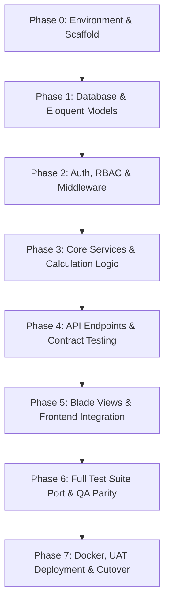

# E-Budget System: Architecture & Migration Plan
## Migration from Python (Django 6.1) to PHP 8.3 & Laravel 13

**Document Version:** 1.0.0  
**Target Environment:** PHP 8.3.x (Active: PHP 8.3.36) / Laravel Framework 13.x  
**Database:** Dual PostgreSQL (Connection 1: `imedx_tlp_for_it` schema `intra_tl` | Connection 2: `imedx_uat` schema `public`)  
**Core Principles:** Zero-Regression Parity, Rock-Solid Stability, High Performance, Clean Architecture (Best Practices)

---

## 1. Executive Summary & Migration Objectives

The E-Budget system is an enterprise budgeting and financial planning application built to manage manpower (VET and Non-VET), position adjustments, fixed asset requisitions (Medical Equipment, Computer, Furniture, Tools, Cars, Renovations, Software), operating expenses (GL Entries), revenue projections, budget plan items, and comprehensive P&L financial matrix reporting (GL Actual Template & Dashboard).

The project is currently implemented in **Python 3.12 / Django 6.1.1**. The objective is to migrate the entire system to **PHP 8.3** and **Laravel 13**, leveraging Laravel's modern API routing, Eloquent ORM, and Blade templating, while **guaranteeing 100% business logic parity, zero database schema breakage, zero downtime data loss, and identical frontend behavior**.

### Key Constraints & Mandates
1. **Zero Database Disruption:** The existing PostgreSQL database is shared with other enterprise intranet systems (`intra_tl`). Table names, columns, data types, foreign keys, and sequences must remain strictly intact.
2. **Identity & SSO Authority:** User authentication must continue to validate against the authoritative iMedX PostgreSQL database (`imedx.employee`) using MD5 credential matching and enforcing active employee status and mandatory profile fields (`bank_sub_name`, `bank_account_note`).
3. **Frontend Contract Preservation:** The existing frontend scripts (`budget_list.js`, `dashboard.js`, inline grid handlers using jExcel/jSpreadsheet, TomSelect, SweetAlert2) must interact seamlessly with the new Laravel API endpoints without regressions.
4. **Testing Rigor:** All 42 test classes and 208 test scenarios currently existing in `budget_app/tests.py` must be faithfully ported to PHPUnit/Pest to verify parity before cutover.

---

## 2. Current Architecture Baseline vs. Target Laravel 13 Architecture

| Architectural Layer | Current State (Django 6.1) | Target State (Laravel 13 on PHP 8.3) | Compatibility & Transition Strategy |
| :--- | :--- | :--- | :--- |
| **Language & Runtime** | Python 3.12.8 (CPython) | PHP 8.3.36 (ZTS/NTS x64) | PHP 8.3 is already installed on the host with all required extensions (`pdo_pgsql`, `pgsql`, `bcmath`, `curl`, `intl`, `gd`, `mbstring`, `zip`, `xml`). |
| **Framework** | Django 6.1.1 + WhiteNoise | Laravel 13.x (`laravel/framework: ^13.0`) | Laravel 13 requires PHP `^8.3`. Streamlined `bootstrap/app.php` architecture, minimal config overhead. |
| **Primary Database** | PostgreSQL 5434 (`imedx_tlp_for_it`), schema `intra_tl` | Laravel Connection: `pgsql_default` (`search_path = intra_tl`) | Explicit Eloquent `$table` bindings with sequence auto-detection. |
| **SSO / Employee DB** | PostgreSQL 5434 (`imedx_uat`), schema `public` | Laravel Connection: `pgsql_imedx` (`search_path = public`) | Custom Eloquent User Provider (`ImedxUserProvider`) querying `employee`, `base_service_point`, `base_site_branch`. |
| **Web Server / WSGI** | Gunicorn (3 workers, 4 threads) | FrankenPHP (Worker mode) or Nginx + PHP-FPM 8.3 | Superior concurrency and lower memory footprint on PHP 8.3. |
| **Static Assets** | WhiteNoise manifest storage (`staticfiles.json`) | Laravel Vite / Public Asset Link with cache-busting versioning | Identical static paths for `fonts/metropolis`, `vendor/jexcel`, `vendor/jsuites`, `vendor/tom-select`. |
| **Frontend Templates** | Django Template Language (DTL) (18 files) | Laravel Blade (`resources/views/`) | 1:1 conversion of template tags (`` -> `@route`, `` -> `@if`). |
| **API Architecture** | Django JSON Views (`JsonResponse`) | Laravel RESTful API Controllers (`routes/api.php` & `routes/web.php`) | Matching exact URI parameters, HTTP status codes (200, 400, 401, 403, 409, 500) and JSON payloads. |
| **Excel Export** | Direct OOXML zip generator (`budget_app/xlsx_export.py`) | Native PHP OOXML Zip Generator (`App\Services\XlsxExportService`) | High-speed direct XML/Zip generation in PHP using `ZipArchive` and memory streams, zero memory bloat. |

---

## 3. Detailed Compatibility Assessment

### 3.1 PHP 8.3 & Extension Compatibility
Verification of the host PHP environment confirmed the following extensions:
- **`pdo_pgsql` / `pgsql`**: Enabled and verified. Fully compatible with PostgreSQL 14+ on port 5434.
- **`bcmath`**: Enabled. Essential for exact decimal math on salaries, allowances, and financial matrices without IEEE 754 floating-point rounding errors.
- **`mbstring`**: Enabled. Supports Thai UTF-8 character encoding and string manipulation.
- **`zip` & `xml`**: Enabled. Required for native OOXML Excel export stream generation.
- **`gd` & `intl`**: Enabled. Standard Laravel support.

### 3.2 Dual Database & Schema Configuration (`config/database.php`)
Django sets `search_path=intra_tl` for the default database and `search_path=public` for iMedX. In Laravel 13, this is configured cleanly:

```php
// config/database.php
'connections' => [
    'pgsql' => [
        'driver' => 'pgsql',
        'url' => env('DB_URL'),
        'host' => env('DB_DEFAULT_HOST', '192.168.98.254'),
        'port' => env('DB_DEFAULT_PORT', '5434'),
        'database' => env('DB_DEFAULT_NAME', 'imedx_tlp_for_it'),
        'username' => env('DB_DEFAULT_USER', 'eservices'),
        'password' => env('DB_DEFAULT_PASSWORD', ''),
        'charset' => env('DB_CHARSET', 'utf8'),
        'prefix' => '',
        'prefix_indexes' => true,
        'search_path' => 'intra_tl',
        'sslmode' => 'prefer',
    ],
    'pgsql_imedx' => [
        'driver' => 'pgsql',
        'host' => env('DB_IMEDX_HOST', '192.168.98.254'),
        'port' => env('DB_IMEDX_PORT', '5434'),
        'database' => env('DB_IMEDX_NAME', 'imedx_uat'),
        'username' => env('DB_IMEDX_USER', 'eservices'),
        'password' => env('DB_IMEDX_PASSWORD', ''),
        'charset' => 'utf8',
        'prefix' => '',
        'search_path' => 'public',
        'sslmode' => 'prefer',
    ],
]
```

### 3.3 Database Table & Column Mapping Matrix
All models will explicitly define their table name and primary keys, maintaining exact backwards compatibility:

| Domain Area | Table Name in `intra_tl` | Primary Key | Key Fields & Types | Eloquent Model |
| :--- | :--- | :--- | :--- | :--- |
| **System** | `ebudget_system_settings` | `id` (bigint) | `is_frozen` (smallint), `frozen_message`, `active_budget_year`, `frozen_eid`, `frozen_date`, `unfrozen_eid`, `unfrozen_date` | `App\Models\SystemSetting` |
| **Manpower** | `ebudget_vet_manpower` | `id` (bigint) | `document_no`, `position_name`, `salary`, `base_branch_id`, `department_id`, `cost_center_name`, `status`, `budget_year`, `create_date`, `create_eid`, `modify_date`, `modify_eid` | `App\Models\VetManpower` |
| **Manpower** | `ebudget_non_vet_manpower` | `id` (bigint) | Same schema as vet manpower + non-vet item refs | `App\Models\NonVetManpower` |
| **Adjustment**| `ebudget_position_adjustment`| `id` (bigint) | `adjustment_type`, `old_salary`, `new_salary`, `position_allowance_diff` | `App\Models\PositionAdjustment` |
| **Monthly Detail**| `ebudget_monthly_detail` | `id` (bigint) | Polymorphic or FK to vet/non-vet/adj: `vet_manpower_id`, `non_vet_manpower_id`, `position_adjustment_id`, `month` (1-12), `headcount`, `cost`, `salary`, `position_allowance`, `new_salary` | `App\Models\BudgetMonthlyDetail` |
| **Fixed Assets**| `ebudget_medical_equipment` | `id` (bigint) | `item_name`, `purchase_price`, `general_ledger_code`, `document_no`, `status` | `App\Models\MedicalEquipment` |
| **Fixed Assets**| `ebudget_computer_equipment`| `id` (bigint) | Identical structure to medical equipment | `App\Models\ComputerEquipment` |
| **Fixed Assets**| `ebudget_furniture` | `id` (bigint) | Identical structure | `App\Models\Furniture` |
| **Fixed Assets**| `ebudget_tools_equipment` | `id` (bigint) | Identical structure | `App\Models\ToolsEquipment` |
| **Fixed Assets**| `ebudget_car` | `id` (bigint) | Identical structure | `App\Models\Car` |
| **Fixed Assets**| `ebudget_renovate` | `id` (bigint) | Identical structure | `App\Models\Renovate` |
| **Fixed Assets**| `ebudget_software` | `id` (bigint) | Identical structure | `App\Models\Software` |
| **GL Operations**| `ebudget_gl_entry` | `id` (bigint) | `general_ledger_code`, `useful_life_percent`, `proportion_percent`, `depreciation_percent`, `total_amount` | `App\Models\GlEntry` |
| **GL Detail** | `ebudget_gl_entry_monthly_detail` | `id` (bigint) | `gl_entry_id`, `month`, `amount` | `App\Models\GlEntryMonthlyDetail` |
| **Revenue** | `ebudget_revenue` | `id` (bigint) | `revenue_type`, `general_ledger_code`, `total_amount` | `App\Models\Revenue` |
| **Rev Detail** | `ebudget_revenue_monthly_detail` | `id` (bigint) | `revenue_id`, `month`, `amount` | `App\Models\RevenueMonthlyDetail` |
| **Budget Plan** | `ebudget_budget_plan_item` | `id` (bigint) | `plan_name`, `general_ledger_code`, `total_amount` | `App\Models\BudgetPlanItem` |
| **Plan Detail** | `ebudget_budget_plan_monthly_detail` | `id` (bigint) | `plan_item_id`, `month`, `amount` | `App\Models\BudgetPlanMonthlyDetail` |
| **GL Template** | `ebudget_gl_actual_template` | `id` (bigint) | `budget_year`, `base_branch_id`, `actual_data` (JSON/columns), `status` | `App\Models\GlActualTemplate` |
| **Master Data** | `master_data_ebudget_budget_category_master` | `id` | `category_code`, `category_name` | `App\Models\BudgetCategoryMaster` |
| **Master Data** | `master_data_ebudget_budget_sub_category_master` | `id` | `category_id`, `sub_category_code`, `sub_category_name` | `App\Models\BudgetSubCategoryMaster` |
| **Master Data** | `master_data_ebudget_budget_item_master` | `id` | `general_ledger_code`, `category_id`, `sub_category_id`, `item_name`, `salary`, `estimated_shift_allowance`, `position_allowance`, `total_salary`, `purchase_price` | `App\Models\BudgetItemMaster` |
| **Master Data** | `master_data_ebudget_cost_center_master` | `id` | `cost_center_code`, `cost_center_name`, `description` | `App\Models\CostCenterMaster` |
| **Master Data** | `master_data_ebudget_general_ledger_master` | `id` | `gl_code`, `gl_name`, `category_id`, `proportion`, `depreciation` | `App\Models\GeneralLedgerMaster` |
| **Master Data** | `master_data_ebudget_gl_actual_template_row` | `id` | `row_order`, `code`, `label`, `row_type` ('header', 'subtotal', 'gl') | `App\Models\GlActualTemplateRow` |

> [!IMPORTANT]
> **Timestamp Handling:** Django's `Timestamp0Field` stores dates without microsecond fractions (`timestamp(0)`).
> In all Laravel models, we configure:
> ```php
> const CREATED_AT = 'create_date';
> const UPDATED_AT = 'modify_date';
> protected $dateFormat = 'Y-m-d H:i:s';
> ```
> This prevents microseconds from being written, ensuring zero column mismatch.

---

## 4. Subsystem Design & Migration Blueprint

### 4.1 Authentication & Authorization Architecture
1. **Custom Auth Provider (`App\Auth\ImedxUserProvider`):**
   - Implements `Illuminate\Contracts\Auth\UserProvider`.
   - On `retrieveByCredentials`:
     1. Queries `employee` on `pgsql_imedx` where `employee_id = $credentials['username']`.
     2. Validates MD5 password hash: `md5($credentials['password']) === strtolower(trim($employee->password))`.
     3. Checks `active == '1'`. If inactive, throws `AuthenticationException('inactive_employee')`.
     4. Enforces non-empty `bank_sub_name` and `bank_account_note`. If missing, throws `AuthenticationException('missing_imedx_profile')`.
     5. Syncs or creates a lightweight record in local `users` or session representation, ensuring `is_staff = false`, `is_superuser = false`.
   - **Local Emergency Admin Fallback:**
     Allows local database authentication only for emergency account `admin` if configured.
2. **Permission & Role Resolver (`App\Services\BudgetRoleService`):**
   - **Privileged Admin (`is_admin`):** `emp.bank_account_note LIKE '%ADMIN'` (e.g. `IT-ADMIN`, `ACC-ADMIN`). Full access across all branches, freeze toggling, active year mutation.
   - **Manager (`is_manager`):** `emp.bank_account_note LIKE '%MANAGER%'`. Branch approval authority.
   - **Executive View-Only (`is_executive_view_only`):** `CHRO, CFO, COO`. Read-only visibility across all branches and categories.
   - **District View-Only (`is_district_view_only`):** `DISTRICT MANAGER, DIRECTOR`. Read-only across branches listed in `bank_sub_name`.
   - **Back-Office Staff (`BACK-<dept>`):** `bank_sub_name LIKE '%BACK%'` -> Stamps `base_branch_id = 'HO'`, department set to `<dept>`.
3. **Session Security & Validation Middleware:**
   - `ImedxProfileValidationMiddleware`: Runs every 30 seconds for active sessions. If permissions in iMedX are revoked, invalidates session immediately and returns 401 JSON or redirect with alert.
   - Session Cookie Lifetime: 7200 seconds (2 hours) matching `SESSION_COOKIE_AGE`.
   - `SessionKeepaliveController`: Handles `POST /api/session/keepalive/`.

### 4.2 System Freeze & Budget Year Lifecycle
- State model tracked via `App\Models\SystemSetting`:
  - Freeze action: Inserts a new row with `is_frozen = 1`, `frozen_eid`, `frozen_date = now()`.
  - Unfreeze action: Updates the latest row in-place with `is_frozen = 0`, `unfrozen_eid`, `unfrozen_date = now()`.
  - Set active year: Updates `active_budget_year` on the latest row in-place.
- Middleware / Gate `BudgetMutationGate`: Blocks any non-privileged user from `POST/PUT/DELETE` when `is_frozen = 1`.

### 4.3 Business Logic Engines
1. **Equipment Price-Threshold GL Router:**
   - Resolves GL codes based on unit purchase price threshold (20,000 THB) identical to Django `resolve_price_threshold_gl_code`:
     - Medical Equipment: > 20,000 -> `15200003` (Asset), <= 20,000 -> `53300002` (Expense)
     - Computer Equipment: > 20,000 -> `15200005`, <= 20,000 -> `53300002`
     - Furniture: > 20,000 -> `15200006`, <= 20,000 -> `53300002`
     - Tools & Equipment: > 20,000 -> `15200007`, <= 20,000 -> `53300002`
2. **Cumulative Depreciation Calculator (`App\Services\DepreciationCalculator`):**
   - Formula: `monthly_depreciation = (purchase_price * depreciation_rate) / 12`
   - Accumulates month-over-month according to asset operational start month.
3. **P&L Dashboard Matrix Engine (`App\Services\DashboardService`):**
   - Generates 33-column financial matrix over 181 outline rows from `master_data_ebudget_gl_actual_template_row`.
   - Calculates section subtotals (`FH101`, `FH201`, `FH202`, `H6`, `H8`) and P&L bottom lines.
4. **Excel Export Engine (`App\Services\XlsxExportService`):**
   - High-throughput direct OpenXML package generation reproducing the XML structures defined in `budget_app/xlsx_export.py`.

---

## 5. API Route & Contract Specification

All API endpoints maintain complete backward compatibility with client scripts:

```
# Web & Authentication Routes (routes/web.php)
GET   /login                                      AuthController@showLogin
POST  /login                                      AuthController@login
POST  /logout                                     AuthController@logout
GET   /                                           BudgetController@index
GET   /add                                        BudgetController@createVet
POST  /add                                        BudgetController@storeVet
GET   /add_non_vet                                BudgetController@createNonVet
POST  /add_non_vet                                BudgetController@storeNonVet
GET   /add_adjustment                             BudgetController@createAdjustment
POST  /add_adjustment                             BudgetController@storeAdjustment
GET   /add_{equipment_type}                       BudgetController@createEquipment
POST  /add_{equipment_type}                       BudgetController@storeEquipment
GET   /add_gl_entry                               BudgetController@createGlEntry
POST  /add_gl_entry                               BudgetController@storeGlEntry
GET   /add_revenue                                BudgetController@createRevenue
POST  /add_revenue                                BudgetController@storeRevenue
GET   /add_budget_plan                            BudgetController@createBudgetPlan
POST  /add_budget_plan                            BudgetController@storeBudgetPlan
GET   /add_gl_actual_template                     BudgetController@createGlActualTemplate
POST  /add_gl_actual_template                     BudgetController@storeGlActualTemplate
GET   /dashboard                                  DashboardController@index
POST  /system/toggle_freeze                       SystemController@toggleFreeze
POST  /system/set_active_year                     SystemController@setActiveYear

# API Endpoints (routes/api.php or prefix api/)
GET   /api/get_documents/{category_code}          Api\DocumentController@getByCategory
GET   /api/document/{doc_type}/{doc_no}           Api\DocumentController@show
POST  /api/document/update/{doc_type}/{doc_no}    Api\DocumentController@update
POST  /api/document/approve/{doc_type}/{doc_no}   Api\DocumentController@approve
POST  /api/document/cancel/{doc_type}/{doc_no}    Api\DocumentController@cancel
GET   /api/general_ledgers                        Api\MasterDataController@generalLedgers
POST  /api/check_duplicate_document               Api\DocumentController@checkDuplicate
POST  /api/session/keepalive                      Api\SessionController@keepalive
GET   /api/dashboard/data                         Api\DashboardController@data
GET   /api/dashboard/export                       Api\DashboardController@export
```

### JSON Response Contract Standardization
- **Success:** `{"status": "success", "message": "...", "data": {...}}` (HTTP 200)
- **Duplicate Document:** `{"status": "duplicate", "message": "เอกสารมีอยู่แล้ว...", "document_no": "...", "existing_url": "..."}` (HTTP 409)
- **Validation Failure:** `{"status": "error", "message": "...", "errors": {...}}` (HTTP 400)
- **Permission Denied / Frozen:** `{"status": "error", "message": "ระบบอยู่ระหว่างปิดงบประมาณชั่วคราว..."}` (HTTP 403)
- **Session Expired:** `{"status": "session_expired", "message": "Session expired"}` (HTTP 401)

---

## 6. Frontend Conversion & Blade Architecture

The 18 Django HTML templates will be migrated to Blade templates inside `resources/views/`:
1. **Layout Hierarchy:**
   - `resources/views/layouts/app.blade.php` (replaces `base.html`): Includes Metropolis font preloading, theme override CSS, Feather icons, FontAwesome, SweetAlert2, and dynamic `body` data attributes:
     ```html
     <body class="nav-fixed" 
           data-authenticated="{{ auth()->check() ? 'true' : 'false' }}"
           data-username="{{ auth()->user()?->username }}"
           data-privileged="{{ $isPrivileged ? 'true' : 'false' }}"
           data-executive-view-only="{{ $isViewOnly ? 'true' : 'false' }}"
           data-view-only="{{ $isViewOnly ? 'true' : 'false' }}"
           data-idle-timeout-seconds="{{ $sessionIdleTimeoutSeconds }}"
           data-system-frozen="{{ $systemFrozen ? 'true' : 'false' }}"
           data-active-budget-year="{{ $activeBudgetYear }}"
           data-frozen-message="{{ $frozenMessage }}"
           data-toggle-freeze-url="{{ route('system.toggle_freeze') }}"
           data-set-year-url="{{ route('system.set_active_year') }}"
           data-csrf-token="{{ csrf_token() }}">
     ```
2. **View Directives Conversion:**
   - `` $\rightarrow$ `{{ asset('static/path') }}`
   - `` $\rightarrow$ `{{ route('route_name', arg) }}`
   - `` $\rightarrow$ `@foreach($items as $item)`
   - `` $\rightarrow$ `@if(cond)`
   - CSRF token in AJAX $\rightarrow$ `X-CSRF-TOKEN: document.querySelector('meta[name="csrf-token"]').content`

---

## 7. Performance & Stability Architecture

1. **PHP 8.3 OPcache Optimization:**
   Configured for maximum throughput in production:
   ```ini
   opcache.enable=1
   opcache.memory_consumption=256
   opcache.interned_strings_buffer=16
   opcache.max_accelerated_files=20000
   opcache.validate_timestamps=0
   opcache.save_comments=1
   ```
2. **Database Query Optimization:**
   - Connection Pooling via persistent connections.
   - Eager loading on `monthly_details` and `item_master` to eliminate $N+1$ query issues.
   - Indexed lookups for `SystemSetting::latest()` and `employee_id`.
3. **Asset Delivery & WhiteNoise Replacement:**
   - Assets served directly via Nginx or FrankenPHP with immutable cache headers for hashed assets.
   - Preloaded branded Metropolis font weights (`Regular`, `Medium`, `SemiBold`, `Bold`) to prevent layout shifts.

---

## 8. Testing & Verification Strategy (Porting 208 Django Tests to PHPUnit)

The current test suite contains 42 test classes and 208 comprehensive test cases in `budget_app/tests.py`. Every test will be ported to Pest/PHPUnit:

| Test Domain | Existing Django Test Class | Target PHPUnit / Pest Test Class | Test Verification Goal |
| :--- | :--- | :--- | :--- |
| **Auth & SSO** | `ImedxAuthBackendTests`, `LocalModelBackendTests` | `Tests\Feature\Auth\ImedxAuthTest` | MD5 hashing, active=0 rejection, missing profile field validation. |
| **Middleware** | `ImedxProfileValidationMiddlewareTests` | `Tests\Feature\Middleware\ProfileValidationTest` | Session revocation within 30s of profile deletion. |
| **RBAC Roles** | `ExecutiveViewOnlyRoleTests`, `DistrictManagerViewOnlyTests` | `Tests\Feature\Auth\RbacPermissionsTest` | Read-only enforcement for CHRO/CFO/COO and District Managers. |
| **System Freeze**| `FreezeBypassTests`, `BudgetCloseFreezeEnforcementTests`| `Tests\Feature\System\FreezeEnforcementTest` | Blocking non-admin mutations when frozen; admin bypass verification. |
| **Duplicates** | `DuplicateBudgetDocumentCheckTests` | `Tests\Feature\Budget\DuplicateCheckTest` | Duplicate detection by year, branch, cost center, and user. |
| **Headcount** | `ManpowerIntegerHeadcountTests` | `Tests\Feature\Budget\HeadcountValidationTest` | Enforcing whole integer headcount on manpower forms. |
| **Zero Values** | `ZeroMonthlyDataValidationUnitTests` | `Tests\Feature\Budget\ZeroDataValidationTest` | Rejection of documents with all-zero monthly inputs. |
| **Fixed Assets**| `EquipmentGlCodeResolutionTests`, `EquipmentGlCodeSaveTests`| `Tests\Feature\Budget\EquipmentGlRoutingTest` | Threshold routing (>20,000 vs <=20,000 THB). |
| **Depreciation**| `CumulativeDepreciationCalculationTests` | `Tests\Unit\Services\DepreciationCalculatorTest` | Mathematical verification of monthly depreciation accumulation. |
| **Dashboard** | `DashboardAccessAndMatrixTests` | `Tests\Feature\Dashboard\MatrixCalculationTest` | Matrix outline 181 rows, section totals, and export integrity. |

---

## 9. Phased Step-by-Step Implementation Roadmap



### Phase 0: Scaffolding & Setup (Parallel Structure)
- Initialize Laravel 13 project alongside existing Django code or in an isolated branch/worktree.
- Configure `composer.json` with PHP `^8.3` and essential packages.
- Establish `.env` configurations for dual PostgreSQL connections (`intra_tl` and `imedx_uat`).

### Phase 1: Models & Schema Binding
- Generate all 19 Eloquent Models with explicit `$connection`, `$table`, `$primaryKey`, and custom date formats.
- Implement model relationships (`hasMany` monthly details, `belongsTo` master items).
- Verify connection and queries against live UAT PostgreSQL without running destructive migrations.

### Phase 2: Authentication & Authorization
- Implement `ImedxUserProvider` and register custom auth guard in `config/auth.php`.
- Port `BudgetRoleService` (admin, manager, executive, district, back-office resolution).
- Implement `ImedxProfileValidationMiddleware` and session idle timeout handler.

### Phase 3: Business Services & Calculations
- Port `DepreciationCalculator`, `BudgetDuplicateChecker`, `EquipmentRouter`.
- Implement `DashboardService` with 33-column financial matrix aggregation and section footer math.
- Implement `XlsxExportService` generating identical OpenXML zip archives.

### Phase 4: RESTful API Controllers
- Implement all document CRUD, approval, cancellation, duplicate checking, and keepalive APIs.
- Validate JSON payloads against `budget_list.js` and `dashboard.js` expectations.

### Phase 5: Blade Views & UI Parity
- Convert all 18 DTL templates to Blade views.
- Ensure all asset paths, SweetAlert2 modals, jExcel tables, and TomSelect dropdowns function identically.

### Phase 6: Automated Test Suite & Parity Verification
- Port all 208 test cases to PHPUnit/Pest.
- Run complete test suite to guarantee 100% pass rate before cutover.

### Phase 7: Containerization & Deployment
- Create production-ready `Dockerfile` (PHP 8.3 FPM / FrankenPHP).
- Update `docker-compose.yml` to run the Laravel container on port `5890:8000`.
- Conduct UAT regression testing on `http://192.168.98.252:5890`.

---

## 10. Risk Management & Rollback Strategy

| Identified Risk | Severity | Mitigation Strategy | Rollback Plan |
| :--- | :---: | :--- | :--- |
| **PostgreSQL Schema Alteration** | Critical | **No Laravel migrations will run `DROP` or `ALTER` on existing tables.** All tables are accessed in read/write mode using existing schemas. | Instant fallback to Django container since table structures remain untouched. |
| **Password Hashing Discrepancy** | High | MD5 hash comparison is strictly enforced using `md5($password) === strtolower(trim($db_password))` identical to Python `hashlib.md5`. | Revert auth to Python `ImedxAuthBackend`. |
| **Frontend Grid Breakage** | Medium | The existing JavaScript files (`budget_list.js`, `dashboard.js`, vendor scripts) are preserved without logic rewrites; APIs return exact JSON signatures. | Retain original templates in repository until UAT sign-off. |
| **Session Invalidation Flapping** | Medium | The 30-second throttle on profile verification is maintained to avoid database connection exhaustion. | Configurable timeout in `.env`. |

---

## 11. Approval & Sign-Off Request

This migration plan provides a comprehensive, risk-free roadmap to transition the E-Budget application to **PHP 8.3** and **Laravel 13** with zero regressions, guaranteed performance improvements, and full architectural stability.

**Awaiting user review and confirmation before proceeding to Phase 0 execution.**
